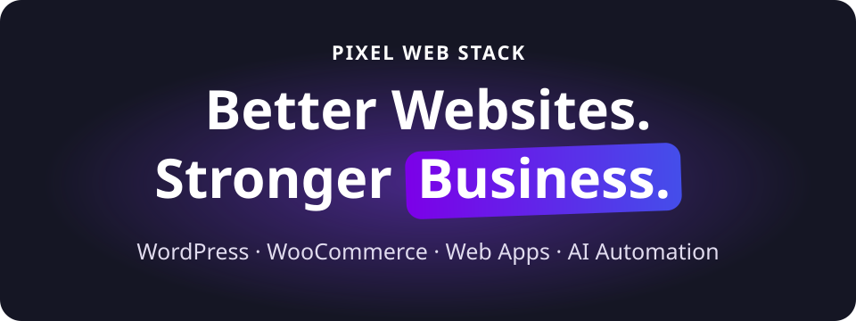

## About Pixel Web Stack

**Web development and AI solutions for businesses and digital agencies.**

We build WordPress websites, WooCommerce stores, and custom web applications. We also connect your tools and automate repetitive workflows so your team can spend more time serving customers. Based in Khulna, Bangladesh, we work with clients internationally.

[Explore our services](https://pixelwebstack.com/services/) · [See our work](https://pixelwebstack.com/projects/) · [Discuss a project](https://pixelwebstack.com/contact/)

## What we do

- **[WordPress development](https://pixelwebstack.com/wordpress-development/).** Build or redesign responsive websites with Divi 5, Elementor, Bricks, or custom WordPress themes and plugins. We can help with migrations, performance, and technical SEO.
- **[WooCommerce and eCommerce](https://pixelwebstack.com/woocommerce-development/).** Build storefronts that make it easy to browse products, check out, and manage orders. Connect payment and other business tools as needed.
- **[Full-stack development and custom applications](https://pixelwebstack.com/full-stack-development/).** Build custom web applications, dashboards, and APIs that fit the way your business operates. Connect existing systems and third-party services to reduce duplicate work.
- **[AI engineering, agents, and business automation](https://pixelwebstack.com/ai-automation/).** Add AI assistants, agents, chatbots, and workflow automation to websites or internal tools where they can reduce manual effort.

## Technologies we work with

 &nbsp;  &nbsp;  &nbsp;  &nbsp; 

| Area | Tools and capabilities |
| --- | --- |
| WordPress and commerce | WordPress, Divi 5, Elementor, Bricks, WooCommerce |
| Front end | HTML, CSS, JavaScript, TypeScript, React, Next.js |
| Back end and data | Node.js, Express.js, MongoDB, API development and integration |
| AI and automation | AI integration, AI agents, assistants, and workflow automation |

## Selected client projects

| Website | Project overview |
| --- | --- |
| [WPOS](https://wpos.be/) | WordPress and Divi 5 website that helps hospitality and retail businesses explore point-of-sale hardware and software. |
| [HyperMed Wellness](https://www.hypermedwellness.com/) | WordPress and Divi 5 redesign with clear therapy pages and direct paths to booking a consultation. |
| [The CX Toolbox](https://thecxtoolbox.com/) | A storefront and resource hub for client-experience templates, including Dubsado templates and Notion boards. |
| [KPS Care](https://kpscare.com/) | A lawn care website with residential and commercial service pages, a project gallery, and a quote request form. |
| [Kevets](https://kevets.co.nz/) | An emergency veterinary website with guidance for pet owners and a separate referral path for veterinary practices. |
| [Pixel Web SEO](https://pixelwebseo.com/) | A digital marketing agency website that organizes SEO, advertising, and web development services. |

## Why work with us

Talk directly with the people building your project. We agree on the scope early, check responsive layouts and key features before launch, and show your team how to manage the finished site.

## Let’s build something great

Tell us what you’re building, what your team needs to do more easily, and when you’d like to launch.

[Start a project with Pixel Web Stack](https://pixelwebstack.com/contact/) · [pixelwebstack@gmail.com](mailto:pixelwebstack@gmail.com)
